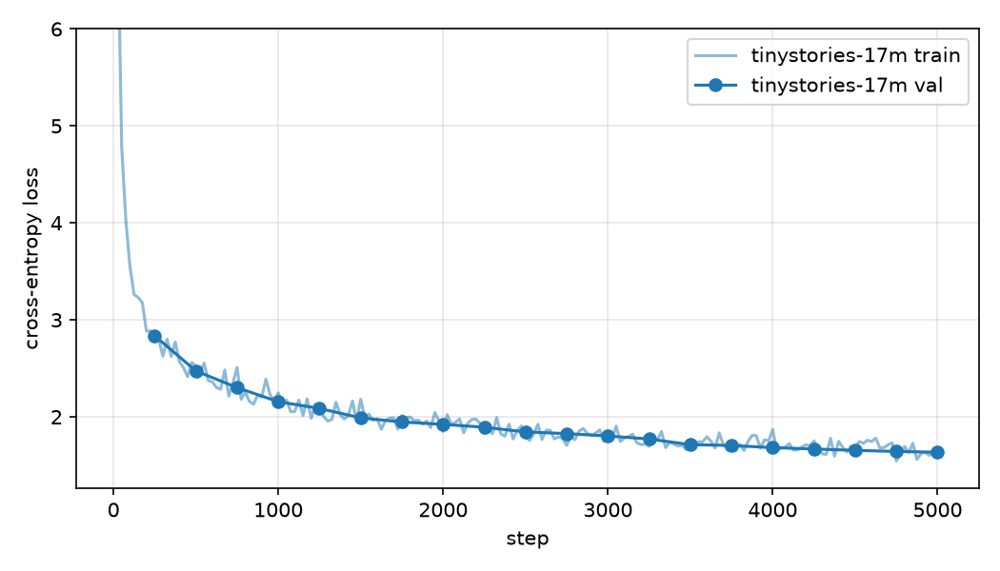

# TinyLM

A GPT-style language model built **from scratch** in PyTorch, covering every step from the tokenizer to serving:

- **Byte-level BPE tokenizer.** Parallel pre-tokenization, incremental merge updates and a lazy max-heap. It produces merges identical to a naive BPE trainer and runs **13.6× faster** on a 5 MB TinyStories sample.
- **Transformer LM.** Pre-norm blocks with RoPE, RMSNorm, SwiGLU and causal multi-head attention. Built only from `nn.Parameter` and tensor ops, so no `nn.Linear`, `nn.Embedding` or fused attention.
- **Training stack.** A hand-written AdamW, cosine LR schedule with warmup, gradient clipping, memory-mapped data loading and checkpoint/resume. Runs on Apple Silicon (MPS), CUDA or CPU.
- **Inference.** KV-cache decoding with temperature and nucleus (top-p) sampling, plus incremental UTF-8 decoding so streamed text is always valid.
- **Serving.** A FastAPI API with server-sent-event token streaming, a small web playground and a Docker image for deployment.
- **Quality.** 55 tests, made up of the Stanford CS336 reference suite plus tests for the KV cache, sampling, tokenizer I/O and the API. GitHub Actions runs lint, the tests and an end-to-end smoke training run on every push.

> The core components follow the specification of [Stanford CS336 Assignment 1](https://github.com/stanford-cs336/assignment1-basics) (MIT). Its unit tests are vendored in `tests/` and are used to check numerical correctness against the reference implementation.

## Quickstart

```bash
brew install uv            # or: curl -LsSf https://astral.sh/uv/install.sh | sh
make setup                 # uv sync: torch, fastapi, pytest, ...
make test                  # full test suite
make smoke                 # 1-minute end-to-end run on the bundled 5 MB sample
```

### Full pipeline (MacBook, 16 GB RAM, MPS)

```bash
make data         # download TinyStories (~2.2 GB)
make tokenizer    # train a 10k-vocab BPE tokenizer  -> artifacts/tokenizer-tinystories-10k
make encode       # tokenize train/valid to uint16 memmaps
make train        # 17M-parameter model, ~41M tokens   -> runs/tinystories-17m/
make generate     # sample a story
make serve        # web playground at http://localhost:8000
```

Hyper-parameters can be overridden without editing configs:

```bash
uv run python scripts/train.py --config configs/tinystories_mps.json --set max_lr=1e-3 run_name=lr1e-3
```

## Results

| | |
|---|---|
| Model | 4 layers · d_model 512 · 16 heads · d_ff 1344 · context 256 · 17.6M non-embedding params |
| Training | 5,000 steps × 32 × 256 = 41M tokens on Apple M5 (MPS) |
| Validation loss | **1.635** (cross-entropy, TinyStories valid) |
| Training time / throughput | 91 min on a fanless MacBook Air M5 · ~7.5k tokens/s avg (8.9k peak; dips to ~4–5k under thermal throttling) |
| BPE, 10k vocab on TinyStories train (2.1 GB) | **26.8 s** end-to-end (parallel pre-tokenization) |
| Encoding TinyStories train with the trained tokenizer | 541M tokens in 29 s (76 MB/s), 4.12 bytes/token |
| BPE speedup vs. naive (5 MB sample, 1k vocab) | **13.6×** (5.24 s → 0.38 s), identical merges |
| Decoding with KV cache vs. without (MPS) | **180.8 vs 54.6 tokens/s (3.3×)** |



Sample (prompt in bold):

> **Once upon a time**, there was a little girl named Lily. She was very impatient. She wanted to play outside, but she didn't want to go outside. One day, she saw a big pile of mud near her house. She was so excited! ...
> From that day on, Lily and her friends always remembered to be careful when playing near the big rock. They learned that it is important to be careful and kind. And they lived happily ever after.

## API

```bash
curl -N -X POST localhost:8000/v1/generate/stream \
  -H 'content-type: application/json' \
  -d '{"prompt": "Once upon a time", "max_new_tokens": 100, "temperature": 0.8, "top_p": 0.9}'
```

| Endpoint | Description |
|---|---|
| `GET /health` | readiness, device, parameter count |
| `POST /v1/generate` | full completion as JSON (`text`, `num_pieces`, `latency_ms`) |
| `POST /v1/generate/stream` | SSE stream: `data: {"delta": "..."}` per token, then `event: done` with stats |
| `GET /` | web playground |

Request fields are validated (for example `1 ≤ max_new_tokens ≤ 1024` and `0 ≤ temperature ≤ 2`). If no model is loaded, the server returns 503.

## Design notes

**BPE training.** The naive algorithm recounts every adjacent pair after every merge, which costs O(merges × corpus). TinyLM instead
1. splits the file at `<|endoftext|>` boundaries and pre-tokenizes the chunks in a process pool, using more chunks than workers to bound per-process memory;
2. keeps global pair counts plus an inverted index from each pair to the words containing it, so a merge only touches the affected words;
3. picks the best pair from a lazily invalidated heap rather than scanning every pair. Ties are broken toward the lexicographically larger byte pair, which matches the reference.

**KV cache and RoPE.** Token positions are computed once per forward pass, *before* any layer appends to the cache. An early version computed them inside each attention layer, so layers ≥ 1 saw positions shifted by the new tokens. `test_kv_cache_matches_full_forward` caught it. When the context window fills up, the decoder re-prefills from the most recent `context_length − 1` tokens so that RoPE positions stay within the precomputed table.

**MPS notes.** Training uses float32. TF32 and `torch.compile` (Inductor) are not used on MPS.

## Layout

```
tinylm/
  tokenizer/   pretokenize.py, train_bpe.py, tokenizer.py
  model/       layers.py (Linear, Embedding, RMSNorm, SwiGLU, RoPE, attention, KV cache), transformer.py
  training/    optim.py (AdamW, cosine LR, grad clipping), utils.py (loss, data, checkpoints)
  generate.py  sampling + streaming decode
server/        FastAPI app + static web playground
scripts/       train_tokenizer, encode_dataset, train, generate, benchmark, plot_curves, export_for_deploy
configs/       tinystories_mps.json, smoke.json
tests/         CS336 reference tests (+ fixtures/snapshots) and tinylm-specific tests
```

## Deploy (Hugging Face Spaces / any Docker host)

```bash
uv run python scripts/export_for_deploy.py runs/tinystories-17m/best.pt deploy/model.pt   # drops optimizer state
docker build -t tinylm . && docker run -p 7860:7860 tinylm
```
